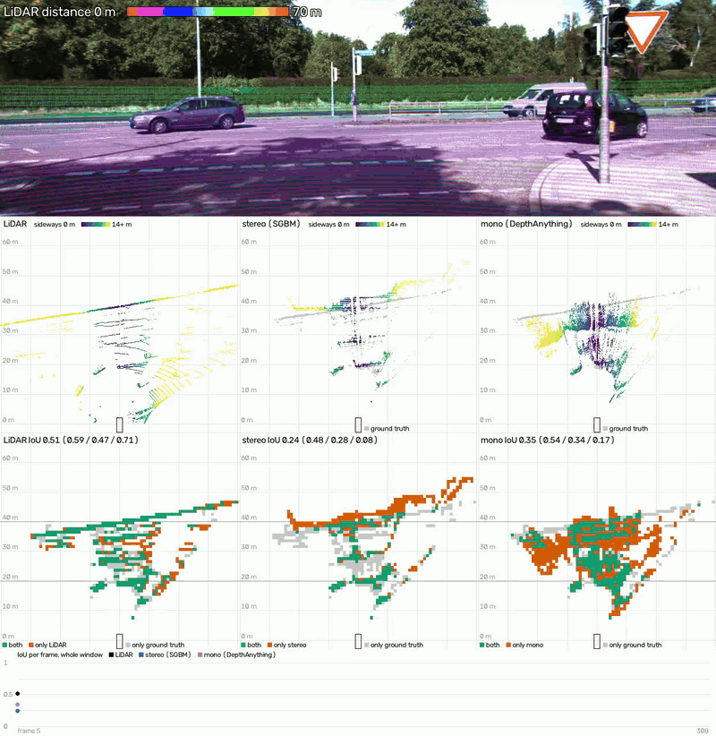

# Bird Eye View from depth

Build a Bird's Eye View (BEV) from depth: LiDAR, stereo vision and monocular depth estimation (DepthAnything). Measure how well each one matches the ground truth depth.

## Demo


## Description
Run on frame sequences from KITTI Raw datasets, with ground truth depth from KITTI Depth Completion. Produce a video with:
- the camera image, with the LiDAR points as dots colored by distance
- a BEV panel per depth source: LiDAR, stereo (SGBM) and mono (Depth Anything V2). Stereo and mono are drawn over the ground truth in grey.
- an agreement panel per source: its occupancy grid against the ground truth's, with the IoU in the label
- a chart of the IoU per frame

The video ends with a table of the mean IoU per source over the drive.

## Method
For each frame and source:
1. Turn the depth into 3D points. Keep the points more than 0.45 m above the road, up to 70 m ahead and about 40 m to each side. These points are the obstacles.
2. Divide the ground plane into 1 m cells. A cell is occupied if it holds at least one point.
3. IoU = cells occupied in both the source and the ground truth / cells occupied in either.

The IoU is given for the whole window and for three distance bands: 0–20 m, 20–40 m and 40–70 m.

## What is measured
How well each source places obstacles on the ground plane, compared with the ground truth. The result is an IoU of two occupancy grids.

### How to read it
- Stereo and mono are used only at the pixels that have ground truth.
- The size of an error does not count: a point 1.5 m off and a point 15 m off both land in a wrong cell.
- The LiDAR row is not an independent result, as the ground truth was itself built from LiDAR, with 11 scans merged per frame.

## Results
Mean IoU with the ground truth on drive `2011_09_26_drive_0014` (304 frames):

| | whole window | 0–20 m | 20–40 m | 40–70 m |
|---|---|---|---|---|
| LiDAR | 0.59 | 0.73 | 0.59 | 0.54 |
| stereo (SGBM) | 0.32 | 0.59 | 0.37 | 0.23 |
| mono (DepthAnything) | 0.17 | 0.25 | 0.19 | 0.13 |

## Thanks
Built as part of the [3D Ascension](https://www.thinkautonomous.ai) program by Think Autonomous.

## Usage

```
python video_shooting.py
```

Renders `../kitty_data/drive14/2011_09_26_drive_0014_sync` (hardcoded in the `__main__` block) into `output/2011_09_26_drive_0014_sync.mp4` and prints the mean IoU table.

`root_folder` must be a KITTI Raw sync folder (`image_02/` left camera, `image_03/` right camera, `velodyne_points/` lidar) with sibling `calib/` (`calib_cam_to_cam.txt`, `calib_velo_to_cam.txt`) and `depth_gt/` folders one directory up, e.g.:

```
kitty_data/drive14/
  calib/
  depth_gt/
  2011_09_26_drive_0014_sync/
```

## Models

- **Depth Anything V2** (`depth-anything/Depth-Anything-V2-Metric-Outdoor-Small-hf`) — monocular depth estimation, runs on CPU
- Stereo depth uses OpenCV's `StereoSGBM`, so there is no model to download.

## Setup

```
pip install -r requirements.txt
```

Run it from inside this folder (`bev_from_depth/`).

Get sync+rectified sequences and calibration files from the [KITTI Raw Data](https://www.cvlibs.net/datasets/kitti/raw_data.php) page.

### Depth Ground Truth
The depth ground truth comes from [KITTI Depth Completion](https://www.cvlibs.net/datasets/kitti/eval_depth.php?benchmark=depth_completion) (`data_depth_annotated.zip`, 14 GB). `data_loading/download_depth_gt.py` downloads only the drives listed in its `DRIVES`, not the full dataset. Set `KITTI_DIR` and `DRIVES` in it, then:

```
python data_loading/download_depth_gt.py https://s3.eu-central-1.amazonaws.com/avg-kitti/data_depth_annotated.zip
```

Only drives from the `train` part of the zip work, because the loader reads `depth_gt/train/`.
